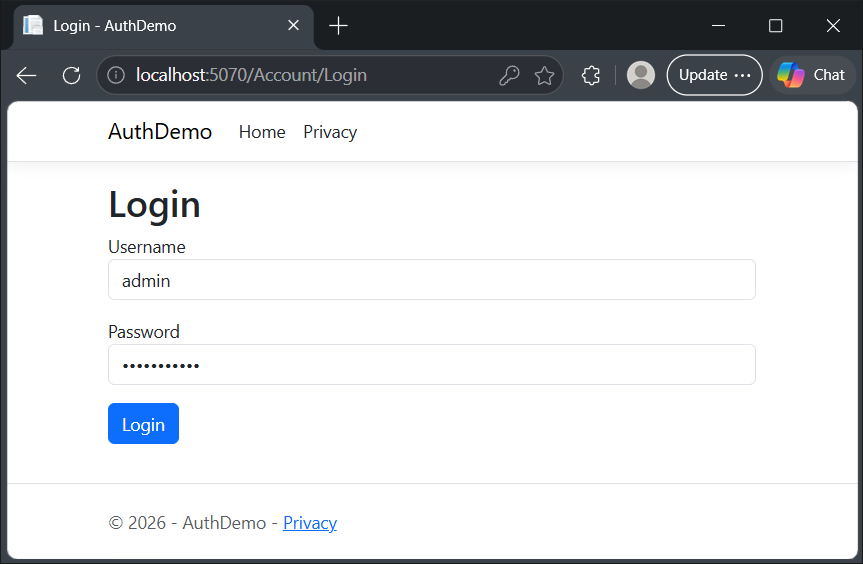
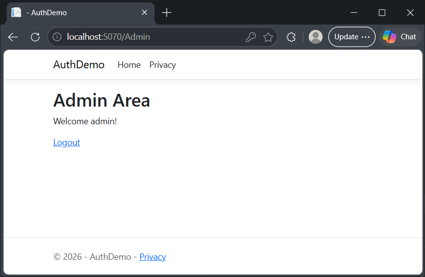

Authentication demo for secure log-ins.
Default user is created within program.cs:
- Username: admin
- Password: Password123
Remove this default user in production builds.

Login Page:

Logged in:

