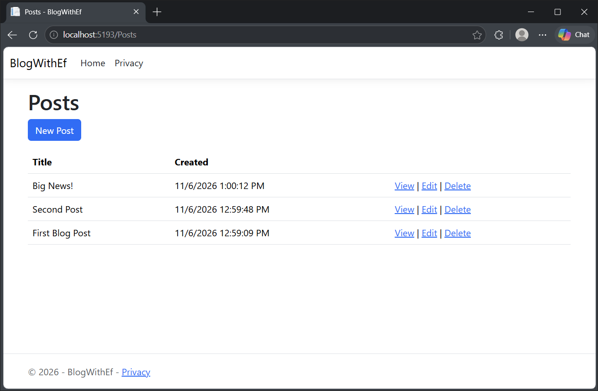
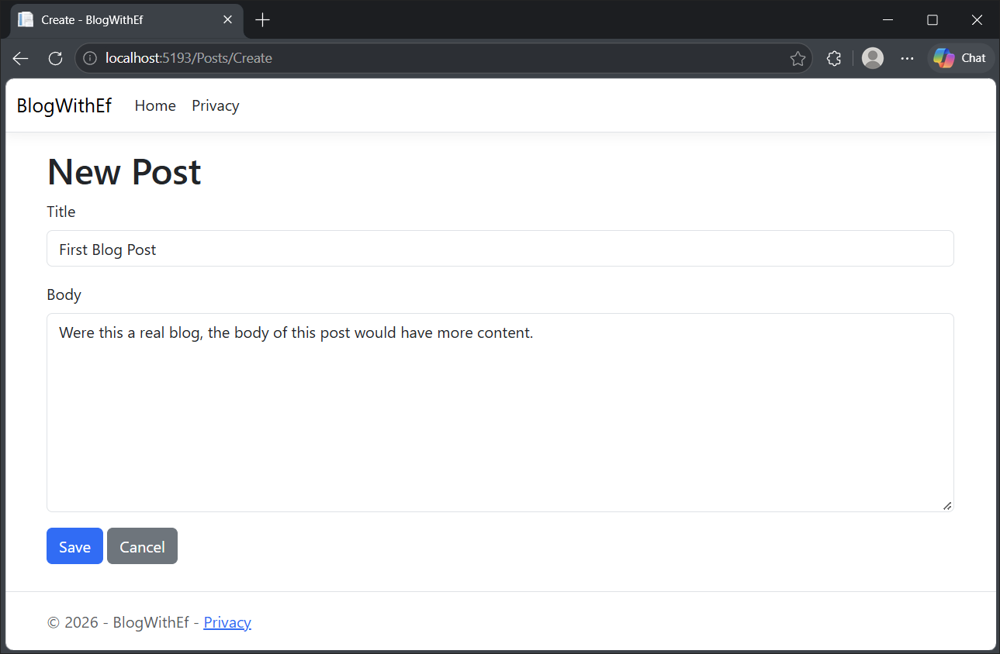
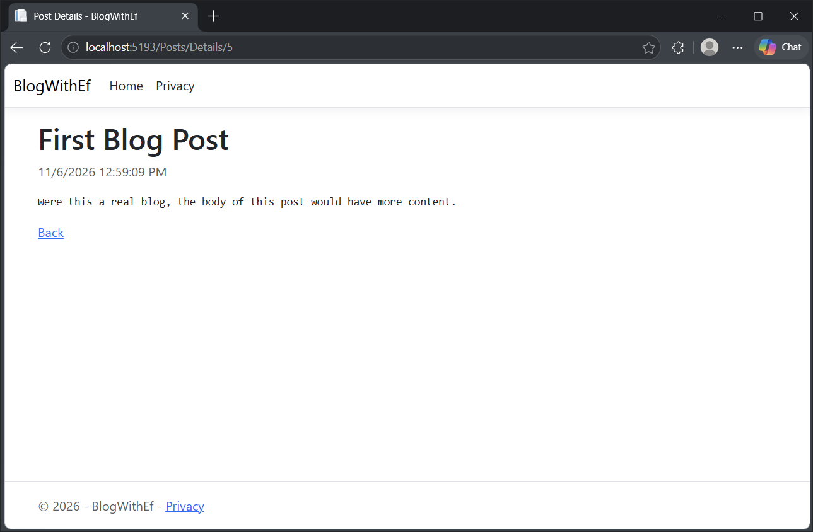
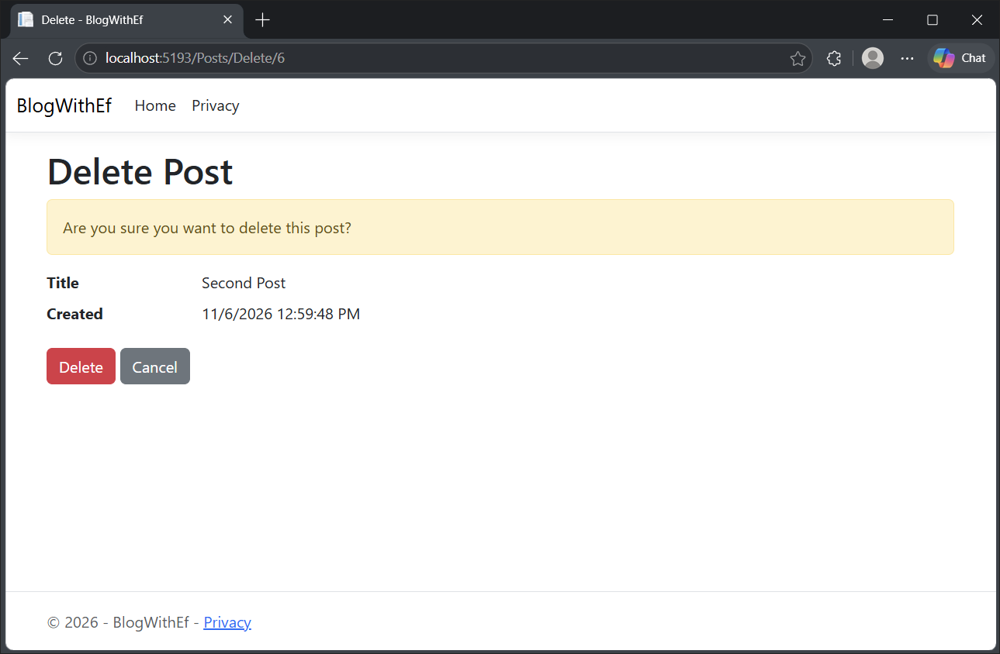

This project functions as a blog post/viewer web application using an entity framework.
When ran, the index page can be accessed at /Posts in the hosted domainspace. (If this is `localhost:[port]`, this would be at `localhost:[port]/Posts`.)

Index "Posts" Page:

New posts can be created from this page using the "New Post" button.
Existing posts can be viewed, edited, or deleted from this menu as well.

New Post Page:

For existing posts, the "edit post" page is a modified version of this page, prefilled with the content of the post you are editing.

View Post Page:

Delete Post Page:

